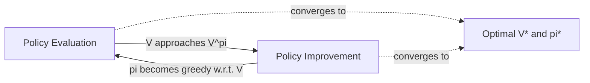

---
type: topic
topic: policy-iteration
module: 3
exam_weight: high
prerequisites: [[01_dynamic_programming]]
tags: [rl, cat2, dynamic-programming, policy-iteration, policy-improvement]
---

# Policy Iteration

---

## 1. Learning Objectives

> [!abstract] By the end of this topic, you should be able to:
> - State and prove the **policy improvement theorem** and explain why it guarantees monotonic improvement.
> - Write out the complete **policy iteration algorithm** from memory, including initialization, evaluation, improvement, and termination.
> - **Hand-trace** policy iteration on small MDPs (3--5 states), showing value tables and policy updates at every step.
> - Explain rigorously **why policy iteration converges** to the optimal policy in finite MDPs.
> - Describe **Generalized Policy Iteration (GPI)** and how it unifies evaluation and improvement into a single framework.

---

## 2. Ground-Up Explanation

### The Starting Point

From [[01_dynamic_programming]], we already know how to **evaluate** a given policy -- that is, compute $V^\pi(s)$ for every state $s$. Policy evaluation answers the question: "How good is this policy?" But evaluation alone is not enough. What we really want is: **How do we find a better policy?**

### The Core Question

Suppose we have finished evaluating policy $\pi$ and now hold the complete value function $V^\pi$. Can we use $V^\pi$ to construct a new policy $\pi'$ that is at least as good as $\pi$ -- and hopefully strictly better?

### The Key Insight

Yes. The idea is surprisingly simple: **act greedily with respect to** $V^\pi$.

At each state $s$, instead of following the action that $\pi$ prescribes, look one step ahead. For every action $a$ available in $s$, compute the expected return you would get if you took $a$ now and then followed $\pi$ forever after. Pick the action that maximizes that expected return.

Formally, the one-step lookahead value of taking action $a$ in state $s$ and then following $\pi$ is exactly the action-value function:

$$Q^\pi(s, a) = \sum_{s', r} p(s', r \mid s, a) \left[ r + \gamma \, V^\pi(s') \right]$$

The new (improved) policy simply picks the best action according to $Q^\pi$:

$$\pi'(s) = \arg\max_a \; Q^\pi(s, a)$$

### Building the Full Algorithm

Policy iteration repeats two phases in a loop:

1. **Policy Evaluation** -- compute $V^\pi$ for the current policy $\pi$.
2. **Policy Improvement** -- construct a new greedy policy $\pi'$ from $V^\pi$.

If $\pi' = \pi$ (the policy did not change), we have found the optimal policy and we stop. Otherwise, set $\pi \leftarrow \pi'$ and repeat.

> [!tip] Intuition
> Policy iteration is like an exam-preparation cycle. First you **assess** how well your current study plan works (evaluation). Then you **revise** the plan based on what you learned (improvement). You keep cycling until the plan stops changing -- at that point, it is optimal.

---

## 3. Analogies

> [!example] The Restaurant Menu Analogy
> Imagine you eat at a restaurant every day and always order the same dish (your current policy). After many visits, you have a reliable sense of how satisfying that dish is on average (policy evaluation).
>
> One day you glance at the full menu and realize another dish looks better based on the ingredients you already know you like (one-step lookahead using your current value estimates). You switch to that dish (policy improvement).
>
> After eating the new dish for a while, you re-evaluate your satisfaction (policy evaluation again). Then you check the menu once more. Eventually, you settle on the best dish and stop switching -- you have converged to the optimal policy.
>
> **Key parallel:** You never need to try every dish exhaustively. At each step you only need your current satisfaction estimates and a single look ahead at what each alternative offers.

> [!example] The Hill-Climbing Analogy
> Think of policy evaluation as measuring your current altitude on a landscape, and policy improvement as taking a step in the steepest uphill direction. Repeating these two operations is a form of greedy hill climbing in policy space. Because the number of deterministic policies in a finite MDP is finite, and each step either improves or matches the current policy, you must reach the peak in a finite number of steps.

---

## 4. Policy Improvement Theorem

The theoretical backbone of the entire policy iteration algorithm is the **policy improvement theorem**. Without it, we would have no guarantee that acting greedily actually produces a better policy.

> [!danger] MUST MEMORIZE -- Policy Improvement Theorem
> Let $\pi$ and $\pi'$ be two deterministic policies. If, for all states $s \in \mathcal{S}$:
>
> $$Q^\pi(s, \pi'(s)) \geq V^\pi(s)$$
>
> then for all states $s \in \mathcal{S}$:
>
> $$V^{\pi'}(s) \geq V^\pi(s)$$
>
> Moreover, if there exists at least one state where the inequality is strict, then there exists at least one state where $V^{\pi'}(s) > V^\pi(s)$.

### What It Says in Words

If, at every state, the action chosen by $\pi'$ is at least as good as the action chosen by $\pi$ (measured under $\pi$'s own value function), then $\pi'$ is a better-or-equal policy overall.

### Proof Sketch (Chain of Inequalities)

> [!note] Proof Sketch
> Start from the hypothesis and unroll one step at a time.
>
> $$V^\pi(s) \leq Q^\pi(s, \pi'(s))$$
>
> Expand $Q^\pi$ using the Bellman equation:
>
> $$= \sum_{s', r} p(s', r \mid s, \pi'(s)) \left[ r + \gamma \, V^\pi(s') \right]$$
>
> Now apply the hypothesis again to $V^\pi(s')$:
>
> $$\leq \sum_{s', r} p(s', r \mid s, \pi'(s)) \left[ r + \gamma \sum_{s'', r'} p(s'', r' \mid s', \pi'(s')) \left[ r' + \gamma \, V^\pi(s'') \right] \right]$$
>
> Keep unrolling. After $k$ steps:
>
> $$\leq \mathbb{E}_{\pi'} \left[ R_{t+1} + \gamma R_{t+2} + \gamma^2 R_{t+3} + \cdots \mid S_t = s \right]$$
>
> $$= V^{\pi'}(s)$$
>
> Therefore $V^\pi(s) \leq V^{\pi'}(s)$ for all $s$. $\blacksquare$

> [!info] Why This Matters for Exams
> The proof technique -- repeatedly substituting the hypothesis inequality into the Bellman expansion -- is a classic pattern. Be ready to reproduce the first two or three steps of the chain and then state "continuing this argument to infinity yields $V^{\pi'}(s)$."

---

## 5. Policy Improvement (Greedy Step)

### The Greedy Policy

Given $V^\pi$, construct the improved policy:

> [!danger] MUST MEMORIZE -- Policy Improvement Formula
> $$\pi'(s) = \arg\max_a \; Q^\pi(s, a) = \arg\max_a \; \sum_{s', r} p(s', r \mid s, a) \left[ r + \gamma \, V^\pi(s') \right]$$

This is called making the policy **greedy** with respect to $V^\pi$.

> [!info] Tie-Breaking
> If multiple actions achieve the same maximum, any consistent tie-breaking rule works. The theory holds as long as the chosen action satisfies $Q^\pi(s, \pi'(s)) \geq V^\pi(s)$.

### When Does Improvement Stop?

Improvement stops when $\pi' = \pi$, meaning the current policy is already greedy with respect to its own value function. At that point:

$$V^\pi(s) = \max_a \; Q^\pi(s, a) = \max_a \; \sum_{s', r} p(s', r \mid s, a) \left[ r + \gamma \, V^\pi(s') \right]$$

This is exactly the **Bellman optimality equation**. Therefore $V^\pi = V^*$ and $\pi = \pi^*$.

> [!success] Key Conclusion
> A policy that is greedy with respect to its own value function satisfies the Bellman optimality equation and is therefore **optimal**.

---

## 6. Policy Iteration Algorithm

### Complete Pseudocode

```
POLICY ITERATION (for finite MDP)

1. Initialization:
   For all s in S:
       V(s) <- arbitrary value  (e.g., 0)
       pi(s) <- arbitrary action in A(s)
   V(terminal) <- 0

2. Policy Evaluation:
   Repeat:
       delta <- 0
       For each s in S:
           v <- V(s)
           V(s) <- sum over s',r of p(s',r|s,pi(s)) * [r + gamma * V(s')]
           delta <- max(delta, |v - V(s)|)
   Until delta < theta  (a small positive threshold)

3. Policy Improvement:
   policy_stable <- true
   For each s in S:
       old_action <- pi(s)
       pi(s) <- argmax_a sum over s',r of p(s',r|s,a) * [r + gamma * V(s')]
       If old_action != pi(s):
           policy_stable <- false

4. If policy_stable is false, go to Step 2.
   Else, return V (approximately V*) and pi (approximately pi*).
```

### Line-by-Line Explanation

> [!note] Step 1 -- Initialization
> We start with an arbitrary value function and an arbitrary deterministic policy. The only hard requirement is that terminal states must have value zero, since no future reward is collected from them.

> [!note] Step 2 -- Policy Evaluation
> This is iterative policy evaluation (covered in [[01_dynamic_programming]]). We sweep through all states, updating each state's value using the Bellman expectation equation for the current policy $\pi$. We repeat until the largest single-state change ($\delta$) falls below a convergence threshold $\theta$.

> [!note] Step 3 -- Policy Improvement
> For each state, we compute the greedy action with respect to the current $V$. If the greedy action differs from the current policy's action at any state, the policy has changed and we must re-evaluate.

> [!note] Step 4 -- Termination Check
> If the policy did not change at any state (`policy_stable` remains true), we have reached the optimal policy. The algorithm terminates.

### Convergence Guarantee

> [!success] Why Policy Iteration Must Converge
> 1. A finite MDP with $|\mathcal{S}|$ states and $|\mathcal{A}|$ actions has at most $|\mathcal{A}|^{|\mathcal{S}|}$ distinct deterministic policies -- a finite number.
> 2. The policy improvement theorem guarantees that each new policy is strictly better than the previous one (unless it is already optimal).
> 3. A strictly increasing sequence over a finite set must terminate.
>
> Therefore, policy iteration converges to $\pi^*$ in a finite number of iterations.
>
> **In practice**, convergence is remarkably fast -- often in far fewer iterations than the total number of policies. For many problems, optimal policies are found in fewer than 10 iterations regardless of state-space size.

---

## 7. Hand-Traced Example

### MDP Definition

> [!example] A 3-State MDP
> **States:** $S = \{s_1, s_2, s_3\}$, plus a terminal state $s_T$.
>
> **Actions:** $A = \{a, b\}$ available in every non-terminal state.
>
> **Discount factor:** $\gamma = 0.9$
>
> **Transitions and Rewards** (all deterministic for clarity):
>
> | State | Action | Next State | Reward |
> |-------|--------|------------|--------|
> | $s_1$ | $a$    | $s_2$      | +2     |
> | $s_1$ | $b$    | $s_3$      | +1     |
> | $s_2$ | $a$    | $s_T$      | +3     |
> | $s_2$ | $b$    | $s_1$      | +0     |
> | $s_3$ | $a$    | $s_T$      | +10    |
> | $s_3$ | $b$    | $s_2$      | +1     |

### Iteration 0 -- Initialization

| State | $V(s)$ | $\pi(s)$ |
|-------|--------|----------|
| $s_1$ | 0      | $a$      |
| $s_2$ | 0      | $a$      |
| $s_3$ | 0      | $a$      |
| $s_T$ | 0      | --       |

Initial policy: $\pi(s_1) = a$, $\pi(s_2) = a$, $\pi(s_3) = a$.

### Iteration 1 -- Policy Evaluation

Under the current policy $\pi$: $s_1 \xrightarrow{a} s_2 (+2)$, $s_2 \xrightarrow{a} s_T (+3)$, $s_3 \xrightarrow{a} s_T (+10)$.

The chains are short (deterministic, reach terminal quickly), so we can solve exactly:

- $V^\pi(s_2) = 3 + 0.9 \cdot V(s_T) = 3 + 0 = 3.0$
- $V^\pi(s_1) = 2 + 0.9 \cdot V^\pi(s_2) = 2 + 0.9(3) = 4.7$
- $V^\pi(s_3) = 10 + 0.9 \cdot V(s_T) = 10 + 0 = 10.0$

| State | $V^\pi(s)$ |
|-------|------------|
| $s_1$ | 4.7        |
| $s_2$ | 3.0        |
| $s_3$ | 10.0       |

### Iteration 1 -- Policy Improvement

For each state, compute $Q^\pi(s, a)$ and $Q^\pi(s, b)$ and pick the max:

**State $s_1$:**
- $Q^\pi(s_1, a) = 2 + 0.9 \cdot V^\pi(s_2) = 2 + 0.9(3.0) = 4.7$
- $Q^\pi(s_1, b) = 1 + 0.9 \cdot V^\pi(s_3) = 1 + 0.9(10.0) = 10.0$
- $\pi'(s_1) = b$ (changed from $a$)

**State $s_2$:**
- $Q^\pi(s_2, a) = 3 + 0.9 \cdot 0 = 3.0$
- $Q^\pi(s_2, b) = 0 + 0.9 \cdot V^\pi(s_1) = 0 + 0.9(4.7) = 4.23$
- $\pi'(s_2) = b$ (changed from $a$)

**State $s_3$:**
- $Q^\pi(s_3, a) = 10 + 0.9 \cdot 0 = 10.0$
- $Q^\pi(s_3, b) = 1 + 0.9 \cdot V^\pi(s_2) = 1 + 0.9(3.0) = 3.7$
- $\pi'(s_3) = a$ (unchanged)

> [!warning] Policy changed at $s_1$ and $s_2$, so we are NOT stable yet. Go back to evaluation.

Updated policy: $\pi(s_1) = b$, $\pi(s_2) = b$, $\pi(s_3) = a$.

### Iteration 2 -- Policy Evaluation

Under the new policy: $s_1 \xrightarrow{b} s_3 (+1)$, $s_2 \xrightarrow{b} s_1 (+0)$, $s_3 \xrightarrow{a} s_T (+10)$.

Chain from $s_3$: terminates immediately.
Chain from $s_1$: $s_1 \to s_3 \to s_T$.
Chain from $s_2$: $s_2 \to s_1 \to s_3 \to s_T$.

Solve:

- $V^\pi(s_3) = 10 + 0.9 \cdot 0 = 10.0$
- $V^\pi(s_1) = 1 + 0.9 \cdot V^\pi(s_3) = 1 + 9.0 = 10.0$
- $V^\pi(s_2) = 0 + 0.9 \cdot V^\pi(s_1) = 0 + 9.0 = 9.0$

| State | $V^\pi(s)$ |
|-------|------------|
| $s_1$ | 10.0       |
| $s_2$ | 9.0        |
| $s_3$ | 10.0       |

### Iteration 2 -- Policy Improvement

**State $s_1$:**
- $Q^\pi(s_1, a) = 2 + 0.9(9.0) = 10.1$
- $Q^\pi(s_1, b) = 1 + 0.9(10.0) = 10.0$
- $\pi'(s_1) = a$ (changed from $b$)

**State $s_2$:**
- $Q^\pi(s_2, a) = 3 + 0 = 3.0$
- $Q^\pi(s_2, b) = 0 + 0.9(10.0) = 9.0$
- $\pi'(s_2) = b$ (unchanged)

**State $s_3$:**
- $Q^\pi(s_3, a) = 10 + 0 = 10.0$
- $Q^\pi(s_3, b) = 1 + 0.9(9.0) = 9.1$
- $\pi'(s_3) = a$ (unchanged)

> [!warning] Policy changed at $s_1$. Not stable. Continue.

Updated policy: $\pi(s_1) = a$, $\pi(s_2) = b$, $\pi(s_3) = a$.

### Iteration 3 -- Policy Evaluation

Chains: $s_1 \xrightarrow{a} s_2 (+2)$, $s_2 \xrightarrow{b} s_1 (+0)$, $s_3 \xrightarrow{a} s_T (+10)$.

Note $s_1$ and $s_2$ form a cycle under this policy. We solve the simultaneous equations:

- $V(s_3) = 10$
- $V(s_1) = 2 + 0.9 \cdot V(s_2)$
- $V(s_2) = 0 + 0.9 \cdot V(s_1)$

Substituting: $V(s_1) = 2 + 0.9(0.9 \cdot V(s_1)) = 2 + 0.81 \cdot V(s_1)$

$0.19 \cdot V(s_1) = 2 \implies V(s_1) = 10.526$

$V(s_2) = 0.9 \times 10.526 = 9.474$

| State | $V^\pi(s)$ |
|-------|------------|
| $s_1$ | 10.526     |
| $s_2$ | 9.474      |
| $s_3$ | 10.0       |

### Iteration 3 -- Policy Improvement

**State $s_1$:**
- $Q^\pi(s_1, a) = 2 + 0.9(9.474) = 10.526$
- $Q^\pi(s_1, b) = 1 + 0.9(10.0) = 10.0$
- $\pi'(s_1) = a$ (unchanged)

**State $s_2$:**
- $Q^\pi(s_2, a) = 3 + 0 = 3.0$
- $Q^\pi(s_2, b) = 0 + 0.9(10.526) = 9.474$
- $\pi'(s_2) = b$ (unchanged)

**State $s_3$:**
- $Q^\pi(s_3, a) = 10 + 0 = 10.0$
- $Q^\pi(s_3, b) = 1 + 0.9(9.474) = 9.526$
- $\pi'(s_3) = a$ (unchanged)

> [!success] Policy is STABLE. No action changed at any state. Algorithm terminates.

### Final Result

| State | $V^*(s)$ | $\pi^*(s)$ |
|-------|----------|------------|
| $s_1$ | 10.526   | $a$        |
| $s_2$ | 9.474    | $b$        |
| $s_3$ | 10.0     | $a$        |

> [!tip] Exam Strategy
> When hand-tracing, always present your work in tables. Write $Q$ values for both actions explicitly so the grader can see your reasoning. Circle or highlight the action that wins at each state.

---

## 8. Generalized Policy Iteration (GPI)

### The Core Idea

Policy iteration as described above performs **complete** policy evaluation (running until convergence) before each improvement step. But this is not strictly necessary. The **Generalized Policy Iteration (GPI)** framework captures the idea that evaluation and improvement can be interleaved in any manner, and convergence to optimality is still guaranteed as long as both processes continue to operate.

> [!info] GPI Principle
> Any algorithm that alternates between some form of policy evaluation (driving $V$ toward $V^\pi$) and some form of policy improvement (driving $\pi$ toward greediness with respect to $V$) will converge to the optimal value function and optimal policy, provided both processes are given sufficient opportunity to operate.

### Why GPI Matters

- **Value iteration** is a special case of GPI where evaluation is truncated to a single sweep before improvement.
- **Asynchronous DP** methods update only a subset of states per sweep -- still GPI.
- Many **model-free** methods (TD learning, SARSA, Q-learning) also follow the GPI pattern.

GPI is therefore the **unifying idea** behind nearly all RL control algorithms.

### Interaction Diagram



> [!note] Tension and Resolution
> Evaluation and improvement pull in competing directions. Improvement changes $\pi$, which invalidates the current $V^\pi$. Evaluation then adjusts $V$ toward the new $V^\pi$, but improvement may change $\pi$ again. Despite this apparent instability, both processes jointly drive the system toward the unique fixed point: $V^*$ and $\pi^*$.

---

## 9. Key Formulas

> [!danger] MUST MEMORIZE -- Policy Improvement Formula
> $$\pi'(s) = \arg\max_a \sum_{s', r} p(s', r \mid s, a) \left[ r + \gamma \, V^\pi(s') \right]$$
>
> **Variables:**
> - $\pi'(s)$: the improved policy's action at state $s$
> - $p(s', r \mid s, a)$: transition dynamics (probability of reaching $s'$ with reward $r$ given state $s$ and action $a$)
> - $\gamma$: discount factor, $0 \leq \gamma < 1$
> - $V^\pi(s')$: value of successor state under the current policy

> [!danger] MUST MEMORIZE -- Action-Value in Terms of State-Value
> $$Q^\pi(s, a) = \sum_{s', r} p(s', r \mid s, a) \left[ r + \gamma \, V^\pi(s') \right]$$
>
> **Variables:**
> - $Q^\pi(s, a)$: expected return from taking action $a$ in state $s$ and then following policy $\pi$
> - This is the one-step lookahead formula that converts $V^\pi$ into $Q^\pi$

> [!danger] MUST MEMORIZE -- Policy Iteration Convergence (Termination) Condition
> The algorithm terminates when the policy is **stable**, i.e.:
>
> $$\pi'(s) = \pi(s) \quad \text{for all } s \in \mathcal{S}$$
>
> Equivalently, when:
>
> $$V^\pi(s) = \max_a \sum_{s', r} p(s', r \mid s, a) \left[ r + \gamma \, V^\pi(s') \right] \quad \text{for all } s$$
>
> This is the **Bellman optimality equation**, confirming $\pi$ is optimal.

> [!info] Bellman Expectation Equation (used in policy evaluation step)
> $$V^\pi(s) = \sum_{a} \pi(a \mid s) \sum_{s', r} p(s', r \mid s, a) \left[ r + \gamma \, V^\pi(s') \right]$$
>
> For a deterministic policy $\pi$, this simplifies to:
>
> $$V^\pi(s) = \sum_{s', r} p(s', r \mid s, \pi(s)) \left[ r + \gamma \, V^\pi(s') \right]$$

---

## 10. Derivations

### Deriving $Q^\pi(s, a)$ from $V^\pi$

> [!note] Derivation: Relating $Q^\pi$ to $V^\pi$
> By definition, $Q^\pi(s, a)$ is the expected return from taking action $a$ in state $s$ and then following $\pi$:
>
> $$Q^\pi(s, a) = \mathbb{E}_\pi \left[ G_t \mid S_t = s, A_t = a \right]$$
>
> Expand the return one step:
>
> $$= \mathbb{E}_\pi \left[ R_{t+1} + \gamma \, G_{t+1} \mid S_t = s, A_t = a \right]$$
>
> The next state and reward are determined by the dynamics $p(s', r \mid s, a)$, and from $s'$ onward the agent follows $\pi$, so $\mathbb{E}_\pi[G_{t+1} \mid S_{t+1} = s'] = V^\pi(s')$:
>
> $$= \sum_{s', r} p(s', r \mid s, a) \left[ r + \gamma \, V^\pi(s') \right]$$
>
> This is the standard one-step lookahead that converts state values into action values.

### Policy Improvement Theorem -- Full Proof Chain

> [!note] Derivation: Policy Improvement Theorem
> **Given:** $Q^\pi(s, \pi'(s)) \geq V^\pi(s)$ for all $s$.
>
> **To show:** $V^{\pi'}(s) \geq V^\pi(s)$ for all $s$.
>
> **Proof:**
>
> Start from the hypothesis:
>
> $$V^\pi(s) \leq Q^\pi(s, \pi'(s))$$
>
> **Step 1.** Expand $Q^\pi$ by one step:
>
> $$= \mathbb{E}\left[ R_{t+1} + \gamma \, V^\pi(S_{t+1}) \mid S_t = s, A_t = \pi'(s) \right]$$
>
> **Step 2.** Apply the hypothesis to $V^\pi(S_{t+1})$:
>
> $$\leq \mathbb{E}\left[ R_{t+1} + \gamma \, Q^\pi(S_{t+1}, \pi'(S_{t+1})) \mid S_t = s, A_t = \pi'(s) \right]$$
>
> **Step 3.** Expand $Q^\pi(S_{t+1}, \pi'(S_{t+1}))$ by another step:
>
> $$= \mathbb{E}\left[ R_{t+1} + \gamma \, R_{t+2} + \gamma^2 \, V^\pi(S_{t+2}) \mid S_t = s, A_t = \pi'(s), A_{t+1} = \pi'(S_{t+1}) \right]$$
>
> **Step 4.** Apply the hypothesis again to $V^\pi(S_{t+2})$ and continue unrolling:
>
> $$\leq \mathbb{E}_{\pi'}\left[ R_{t+1} + \gamma \, R_{t+2} + \gamma^2 \, R_{t+3} + \cdots \mid S_t = s \right]$$
>
> $$= V^{\pi'}(s)$$
>
> Therefore: $V^\pi(s) \leq V^{\pi'}(s)$ for all $s$. $\blacksquare$
>
> The key technique is repeated application of the inequality hypothesis at each time step, combined with expansion of $Q^\pi$ via the dynamics model. The expectations transition from being under $\pi$ to being under $\pi'$ as each action is replaced.

---

## 11. Common Mistakes

> [!warning] Mistake 1: Forgetting the Stability Check
> The algorithm only terminates when the policy is **stable** (no action changed at any state). A common exam error is to stop after one round of improvement, or to forget to compare $\pi'(s)$ with $\pi(s)$ at every state. If even one state's action changes, you must re-evaluate.

> [!warning] Mistake 2: Confusing $V^\pi$ with $V^*$
> During policy iteration, $V^\pi$ is the value function **of the current (possibly suboptimal) policy**. It equals $V^*$ only when the algorithm terminates. Do not use the Bellman optimality equation during intermediate evaluation steps -- use the Bellman expectation equation for the current $\pi$.

> [!warning] Mistake 3: Not Setting $V(\text{terminal}) = 0$
> Terminal states must always have value zero. Forgetting this initialization corrupts all value computations because successor-state values feed back into every update. Always explicitly set $V(s_T) = 0$ and never update terminal states.

> [!warning] Mistake 4: Thinking One Round Gives Optimal Policy
> A single policy improvement step can improve the policy, but it does **not** generally yield the optimal policy. The greedy improvement uses $V^\pi$ for the old policy, not $V^*$. It typically takes multiple evaluate-improve cycles to converge.

> [!warning] Mistake 5: Forgetting to Re-evaluate After Improvement
> After the policy changes, the old $V^\pi$ is no longer valid for the new policy. You must run policy evaluation again. Skipping this step means the next improvement uses stale values and may not actually improve the policy.

---

## 12. Self-Check Questions

> [!question]- Q1: State the policy improvement theorem in one sentence.
> If, for every state $s$, the action chosen by $\pi'$ has action-value $Q^\pi(s, \pi'(s))$ at least as large as $V^\pi(s)$, then $\pi'$ is at least as good as $\pi$ at every state: $V^{\pi'}(s) \geq V^\pi(s)$ for all $s$.

> [!question]- Q2: Why must policy iteration converge in a finite number of steps?
> A finite MDP has a finite number of deterministic policies ($|\mathcal{A}|^{|\mathcal{S}|}$). Each policy improvement step produces a strictly better policy (or the same if already optimal). A strictly increasing sequence over a finite set must terminate. Therefore policy iteration converges in at most $|\mathcal{A}|^{|\mathcal{S}|}$ iterations.

> [!question]- Q3: What equation does $V^\pi$ satisfy when the policy is stable (no further improvement possible)?
> The Bellman optimality equation: $V^\pi(s) = \max_a \sum_{s',r} p(s',r \mid s,a)[r + \gamma V^\pi(s')]$ for all $s$. This confirms $V^\pi = V^*$ and $\pi = \pi^*$.

> [!question]- Q4: How does value iteration differ from policy iteration in the GPI framework?
> Value iteration truncates the policy evaluation step to a **single sweep** (one update per state) before performing policy improvement. Policy iteration runs evaluation to full convergence before improving. Both are instances of Generalized Policy Iteration and converge to the same optimal solution.

> [!question]- Q5: In the policy improvement step, what formula do you use to decide the new action at each state?
> $\pi'(s) = \arg\max_a \sum_{s',r} p(s',r \mid s,a)[r + \gamma V^\pi(s')]$. You compute the expected one-step lookahead return for every available action and pick the one with the highest value.

> [!question]- Q6: Can policy iteration get stuck in a cycle where it alternates between two non-optimal policies?
> No. The policy improvement theorem guarantees that each new policy is **strictly** better than the previous one (unless it is already optimal). Strict improvement rules out cycles.

> [!question]- Q7: What happens if you use an incorrect (not fully converged) $V^\pi$ in the policy improvement step?
> The resulting greedy policy may not be a true improvement. However, under GPI, as long as evaluation and improvement continue to operate, the system still converges to optimality. Full convergence of $V^\pi$ is sufficient but not strictly necessary at each step.

---

## 13. Concept Links

> [!tip] Related Topics
> - **Prerequisites:** [[01_dynamic_programming]] -- Policy evaluation (iterative method to compute $V^\pi$) is a subroutine of policy iteration.
> - **Next topic:** [[03_value_iteration]] -- A special case of GPI that truncates evaluation to one sweep per iteration.
> - **Control methods:** [[05_monte_carlo_control]] -- Model-free analog of policy iteration using sampled returns instead of known dynamics.
> - **Reference:** [[cat2_08_formula_sheet]] -- Quick-access sheet with all key equations including policy iteration formulas.

---

> [!abstract] Chapter Summary
> **Policy iteration** alternates between two phases: (1) **policy evaluation**, which computes $V^\pi$ for the current policy, and (2) **policy improvement**, which constructs a new policy by acting greedily with respect to $V^\pi$. The **policy improvement theorem** guarantees that the new policy is at least as good as the old one. When the policy stops changing, it satisfies the Bellman optimality equation and is therefore optimal. The broader principle of **Generalized Policy Iteration** says that any interleaving of evaluation and improvement converges to optimality, unifying policy iteration, value iteration, and many model-free methods under a single framework.
