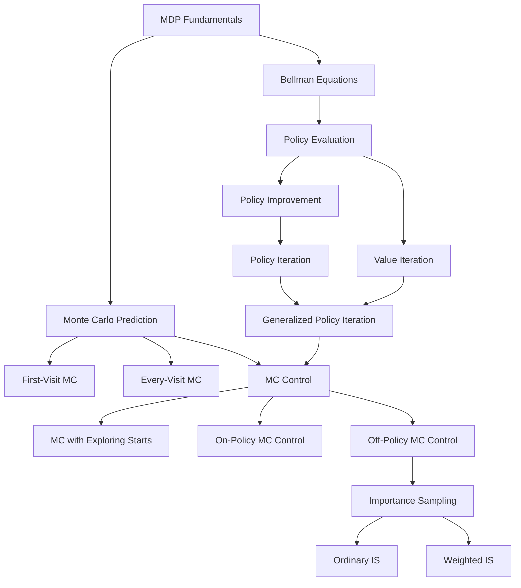

---
type: roadmap
subject: Reinforcement Learning CAT-2
topics: [dynamic-programming, monte-carlo, importance-sampling]
tags: [rl, cat2, roadmap]
---

# Reinforcement Learning CAT-2 - Study Roadmap

## Concept Dependency Map

## Topic Priority

| Priority | Topic | Complexity | Exam Weight | File |
|----------|-------|------------|-------------|------|
| 1 | Policy Evaluation (Iterative) | Medium | High | [[01_dynamic_programming]] |
| 2 | Policy Iteration | High | High | [[02_policy_iteration]] |
| 3 | Value Iteration | Medium | High | [[03_value_iteration]] |
| 4 | Monte Carlo Prediction | Medium | High | [[04_monte_carlo_prediction]] |
| 5 | Monte Carlo Control | High | High | [[05_monte_carlo_control]] |
| 6 | Importance Sampling | Medium-High | Medium-High | [[06_importance_sampling]] |

## Suggested Study Order

1. **Start with DP foundations** - Policy Evaluation is the building block for everything else
2. **Policy Iteration** - builds directly on policy evaluation + policy improvement theorem
3. **Value Iteration** - simplification of policy iteration; compare and contrast
4. **Monte Carlo Prediction** - shift from model-based to model-free; first-visit vs every-visit
5. **Monte Carlo Control** - applying MC to find optimal policies; exploring starts, epsilon-greedy
6. **Importance Sampling** - enables off-policy learning; ordinary vs weighted

**Rationale**: DP methods establish the theoretical foundation (Bellman equations, iterative computation). MC methods build on the same goals but without requiring a model. Importance sampling is a technique used within off-policy MC.

## Quick Reference

| Resource | Link |
|----------|------|
| All Worked Problems | [[cat2_07_worked_problems]] |
| Formula Sheet | [[cat2_08_formula_sheet]] |
| Quick Review / Cheat Sheet | [[cat2_09_quick_review]] |

## Key Distinctions to Master

| Concept A | Concept B | Key Difference |
|-----------|-----------|----------------|
| Prediction | Control | Prediction estimates V/Q; Control finds optimal policy |
| On-Policy | Off-Policy | On-policy evaluates the policy it follows; off-policy uses a different behavior policy |
| Model-Based (DP) | Model-Free (MC) | DP requires transition probabilities p(s',r\|s,a); MC learns from experience |
| First-Visit MC | Every-Visit MC | First-visit averages returns from first occurrence only; every-visit from all |
| Ordinary IS | Weighted IS | Ordinary IS is unbiased but high variance; weighted IS is biased but lower variance |
| Policy Iteration | Value Iteration | PI alternates full evaluation + improvement; VI combines into single update |
| Bootstrapping (DP) | Sampling (MC) | DP updates from estimated values; MC updates from actual complete returns |
